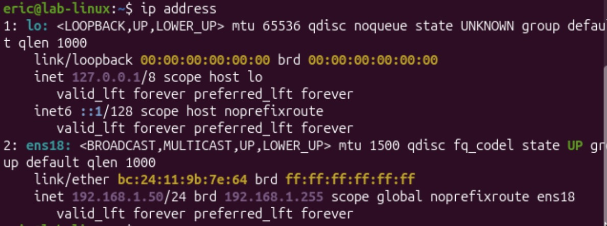
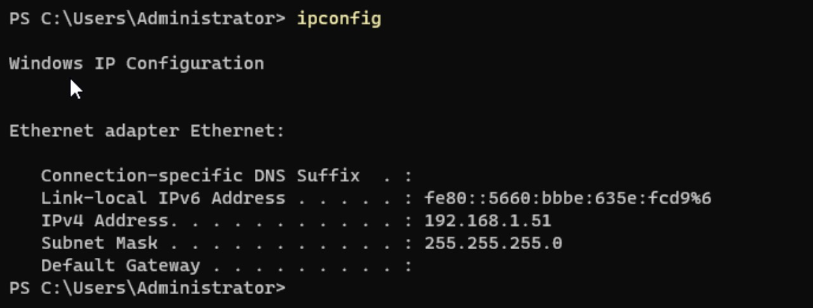

# Labbmiljö, Git, CLI och AI

## 1. Introduktion


## 2. Labbmiljö & Nätverk
Labbmiljön körs i Proxmox VE 9.2.21 och består av en Linux-server och en Windows-klient. Båda är anslutna till en isolerad Linux-brygga (vmbr1) utan fysisk nätverksport, vilket gör att de kan kommunicera med varandra men inte med omvärlden.

### Virtuella maskiner
| VMID | VM | OS | CPU | RAM | Disk | Nätverk |
|---|---|---|---|---|---|---|
| 100 | lab-linux | Ubuntu 26.04 LTS | 2 vCPU | 4 GB | 32 GB | Brygga `vmbr1` (internt) |
| 101 | lab-windows | Windows Server 2025 | 2 vCPU | 4 GB | 64 GB | Brygga `vmbr1` (internt) |

### Nätverkskonfiguration
| Hostname | Operativsystem | IP-adress | Subnätmask | Standard Gateway |
|---|---|---|---|---|
| lab-linux | Ubuntu 26.04 LTS | 192.168.1.50 | 255.255.255.0 | Ingen* |
| lab-windows | Windows Server 2025 | 192.168.1.51 | 255.255.255.0 | Ingen* |




*Internt nätverk utan router, därför behövs ingen gateway.


### Val av nätverkstyp
Jag skapade en separat brygga, vmbr1, under Datacenter -> <nod> (pve i mitt fall) -> System -> Network -> Create -> Linux Bridge, utan att ange någon "Bridge port". Den fungerar då som ett internt nätverk: maskinerna når varandra men är isolerade från värdens fysiska nätverk och internet. Båda VM:arna fick sitt nätverkskort kopplat till vmbr1 under Hardware -> Network Device.

## 3. Kommandoradsgenomförande

Alla kommandon finns samlade i skripten [linux.sh](linux.sh) och [windows.ps1](windows.ps1), så att uppgiften kan upprepas exakt på nytt.

### 3.1 Linux (Bash)
Skriptet körs på lab-linux med `sudo bash linux.sh`, eftersom det kräver root-behörighet att skapa kataloger under `/var`, skapa grupper och ändra ägare.

**1. Skapa mappen och filen**
```bash
mkdir -p /var/systementor/konsultdata
touch /var/systementor/konsultdata/anteckningar.txt
```
`-p` skapar även den överliggande mappen `/var/systementor` om den saknas.

**2. Skapa gruppen konsulter**
```bash
getent group konsulter >/dev/null || groupadd konsulter
```
`getent` kontrollerar först om gruppen redan finns, så att skriptet inte avbryts vid en andra körning.

**3. Tilldela gruppen och sätt behörigheter (Least Privilege)**
```bash
chown root:konsulter /var/systementor/konsultdata /var/systementor/konsultdata/anteckningar.txt
chmod 750 /var/systementor/konsultdata
chmod 640 /var/systementor/konsultdata/anteckningar.txt
```

| Objekt | Läge | Ägare (root) | Grupp (konsulter) | Övriga |
|---|---|---|---|---|
| `konsultdata/` | `750` (`drwxr-x---`) | läsa, skriva, gå in | läsa, gå in | inget |
| `anteckningar.txt` | `640` (`-rw-r-----`) | läsa, skriva | läsa | inget |

Principen om lägsta behörighet innebär att varje användare bara får den åtkomst som behövs. Konsulterna kan läsa innehållet men inte ändra eller ta bort det, och användare utanför gruppen har ingen åtkomst alls. Övriga kan inte ens lista mappens innehåll eftersom de saknar `x`-rättighet på katalogen.

**4. Inspektera behörigheterna**
```bash
ls -la /var/systementor/konsultdata
ls -ld /var/systementor/konsultdata
```
`ls -la` listar filerna i mappen med rättigheter, ägare och grupp. `ls -ld` visar rättigheterna på själva mappen. Utskriften bekräftar `drwxr-x--- root konsulter` för mappen och `-rw-r----- root konsulter` för filen.

**5. Verifiera nätverket**
```bash
ping -c 4 192.168.1.51
ip addr show
```
`ping -c 4` skickar fyra ICMP-paket till Windows-VM:en. `ip addr show` visar nätverkskortet med IP-adressen 192.168.1.50/24.

### 3.2 Windows (PowerShell)
Skriptet körs på lab-windows i PowerShell som administratör med `.\windows.ps1`.

**1. Skapa mappen**
```powershell
New-Item -ItemType Directory -Path "C:\Systementor\KonsultData" -Force
```
`-Force` skapar även `C:\Systementor` om den saknas och ger inget fel om mappen redan finns.

**2. Inspektera behörighetsstrukturen (ACL)**
```powershell
Get-Acl -Path "C:\Systementor\KonsultData" | Format-List
(Get-Acl -Path "C:\Systementor\KonsultData").Access |
    Format-Table IdentityReference, FileSystemRights, AccessControlType, IsInherited -AutoSize
```
`Get-Acl` visar mappens ägare och åtkomstlista (ACL). Den andra raden listar varje regel (ACE) med vem regeln gäller, vilka rättigheter den ger, om den tillåter eller nekar och om den är ärvd. Eftersom mappen är nyskapad ärvs alla regler (`IsInherited = True`) från `C:\`. Det innebär att administratörer och SYSTEM får full åtkomst och att vanliga användare (`BUILTIN\Users`) får läsa och köra.

**3. Verifiera nätverket**
```powershell
Test-Connection -ComputerName 192.168.1.50 -Count 4
ipconfig /all
```
`Test-Connection` är PowerShells motsvarighet till `ping` och skickar fyra ICMP-paket till Linux-VM:en. `ipconfig /all` visar nätverkskortets IP-adress (192.168.1.51), subnätmask och att ingen standardgateway är satt.

**Brandvägg och ICMP**
Windows Server blockerar som standard inkommande ICMP Echo Request. Därför kan Windows nå Linux, men ping från Linux till Windows misslyckas tills en brandväggsregel öppnar för det:
```powershell
New-NetFirewallRule -DisplayName "ICMPv4-In" -Protocol ICMPv4 -IcmpType 8 -Direction Inbound -Action Allow
```
Regeln öppnar bara för ping (ICMP typ 8) och inget annat, vilket är i linje med principen om lägsta behörighet.


## 4. Git & Versionshantering


## 5. AI-logg och Utvärdering

> Förklara kortfattat vilken motsvarighet Internal Network har i proxmox

Claudes svar: 
Motsvarigheten till VirtualBox Internal Network i Proxmox är en Linux-brygga utan fysiskt nätverkskort.

Så här gör du:

    Gå till Datacenter → [din nod] → System → Network → Create → Linux Bridge.
    Ge den ett namn, t.ex. vmbr1.
    Lämna Bridge ports tomt (ingen koppling till fysiskt NIC).
    Lämna IPv4/IPv6 tomt, så att värden inte deltar i nätet.
    Klicka Apply Configuration.
    Koppla VM:arnas nätverkskort till vmbr1.

VM:arna på vmbr1 kan då bara prata med varandra, precis som i ett Internal Network. Det finns ingen åtkomst till värden eller till omvärlden, om du inte själv sätter upp t.ex. en router-VM med ett ben i varje nät.

Bra att veta:

    Om du ger bryggan en IP-adress fungerar den i stället som VirtualBox Host-only, eftersom värden då kan nå VM:arna.
    Alternativt kan du använda SDN (Datacenter → SDN) med en Simple zone och en VNet utan gateway och SNAT. Det ger samma isolering och fungerar även över flera noder i ett kluster om du väljer t.ex. VXLAN.
    Du kan också isolera trafik med VLAN-taggar på en befintlig VLAN-aware brygga.
